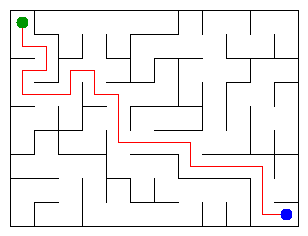

# Assignment 3 — Maze Escape

**Course:** Design and Analysis of Algorithms  
**Student:** Aidana Tumenbai  
**Group:** SE-2511  
**Student ID:** 253203  
**Programming Language:** Java 25

## 1. Project Description

In this assignment, I implemented different graph algorithms to generate and solve a maze.

The project includes Disjoint Set Union (DSU), Kruskal's algorithm, Prim's algorithm, Depth First Search (DFS), Kosaraju's algorithm, topological ordering, and shortest paths in a DAG.

I used the provided starter project and generated my own input files using student ID 253203.

## 2. Program Output

The program was compiled and executed successfully.

```text
Broken: 107
Kept: 88
Last broken wall: 157
MST cost: 26240
Heaviest broken wall: 727
Path length: 23
DFS visited: 73
Dead ends: 30
Zones: 9
Largest zone: 23
Is DAG: 0
Flow stages: 5
Fastest route cost: 9
```

## 3. Mission 0 — Disjoint Set Union

I implemented the DisjointSet class with four methods:

- find() finds the root of a set.
- union() joins two different sets and returns false if they are already connected.
- connected() checks whether two elements belong to the same set.
- count() returns the number of connected components.

I used union by size and path compression to improve performance.

I also added checks to DisjointSetTest.java to test different situations, including duplicate unions and large sets.

## 4. Mission 1 — Build the Maze

I processed the walls in their original file order.

For each wall, I used DSU to check whether the two cells were already connected. If they were not connected, I broke the wall. Otherwise, I kept it.

My results:

- Broken walls: 107
- Kept walls: 88
- Last broken wall: 157

### Why is Broken always R*C - 1?

A maze with one path between every pair of cells is a tree.

A tree with n vertices always has n-1 edges. Since there are R*C cells, exactly R*C-1 walls must be broken.

### Why is Kept always (R-1)*(C-1)?

The total number of internal walls is:

R*(C-1) + C*(R-1)

After breaking R*C-1 walls, the remaining number is:

(R-1)*(C-1)

## 5. Mission 2 — Cheapest Maze

I implemented Kruskal's and Prim's algorithms to calculate the minimum spanning tree.

Kruskal sorts all walls by cost and uses DSU to avoid cycles.

Prim starts from one cell and uses a priority queue to choose the cheapest available edge that connects a new cell.

Both algorithms find an MST with the same minimum total cost.

My results:

- MST cost: 26240
- Heaviest broken wall: 727

## 6. Mission 3 — Escape

I implemented DFS to find the path from the starting cell to the exit.

I used an explicit stack instead of recursion to avoid stack overflow in large mazes.

DFS checks neighbours in the following order:

Up, Right, Down, Left.

My results:

- Path length: 23
- DFS visited: 73
- Dead ends: 30

### Why is there exactly one path?

Mission 1 creates a spanning tree.

A tree is connected and has no cycles. Therefore, there is exactly one simple path between the starting cell and the exit.

## 7. Mission 4 — Zones

I implemented Kosaraju's algorithm to find strongly connected components in the directed slide graph.

The algorithm uses two DFS passes.

The first pass calculates the finishing order of vertices.

The second pass explores the reversed graph in decreasing finishing order to find strongly connected components.

### Why do we use the reversed graph?

The reversed graph helps identify the exact vertices belonging to each strongly connected component.

Processing the vertices in decreasing finishing order prevents the second pass from incorrectly combining different components.

### Why is the graph a DAG when Zones equals n?

If the graph has a directed cycle, the vertices on that cycle belong to a strongly connected component containing more than one vertex.

If every vertex belongs to its own component, there are no directed cycles, because the input has no self-loops.

My results:

- Zones: 9
- Largest zone: 23
- Is DAG: 0

## 8. Mission 5 — Fastest Route

I created a graph where each vertex represents a strongly connected component.

I processed the components in topological order.

For each edge, I updated the longest chain and the minimum distance from the starting zone.

I used dynamic programming instead of a priority queue.

### Why is topological order enough?

The graph of strongly connected components is always a DAG.

In topological order, all edges go from earlier components to later components. Therefore, we can compute the shortest paths in one pass.

### What is the time complexity?

Building the component graph and processing its edges takes O(n+m) time, where n is the number of cells and m is the number of slides.

My results:

- Flow stages: 5
- Fastest route cost: 9

## 9. Maze Visualization

The program generates the maze visualization.



The interactive version is saved as output/maze.html.

## 10. Benchmark Results

I compared the execution times of Kruskal's and Prim's algorithms on three maze sizes.

Each algorithm was executed five times, and the average execution time was calculated.

| Maze Size | Kruskal (ms) | Prim (ms) |
|---|---:|---:|
| 100x100 | 34 | 16 |
| 300x300 | 124 | 127 |
| 1000x1000 | 2322 | 3683 |

### Analysis

As the maze size increases, both algorithms need more time to process the edges.

For the smallest maze, Prim was faster. On the 300x300 maze, their execution times were similar. On the 1000x1000 maze, Kruskal was faster in my measurements.

Both algorithms have efficient implementations, but their performance also depends on sorting and priority queue operations.

## 11. Time and Space Complexity

| Algorithm | Time Complexity | Space Complexity |
|---|---|---|
| DSU operations | O(alpha(n)) amortized | O(n) |
| Build Maze | O(m*alpha(n)) | O(n) |
| Kruskal | O(m log m) | O(n+m) |
| Prim | O(m log m) | O(n+m) |
| DFS | O(n) | O(n) |
| Kosaraju | O(n+m) | O(n+m) |
| Fastest Route | O(n+m) | O(n+m) |

Here, n is the number of vertices or cells, m is the number of edges, and alpha(n) is the inverse Ackermann function.

## 12. Testing

The project uses Java 25.

Commands used:

```bash
java tools/MakeVariant.java 253203 data
javac -d out src/*.java
java -cp out Main
java tools/Check.java
java -cp out DisjointSetTest
java -cp out Bench
```

The program compiled and produced the required 13 output values.

## 13. AI Use

I used ChatGPT to help with understanding the assignment, preparing Java implementations, explaining algorithms, and writing the README report.

I used IntelliJ IDEA to compile and run the project and checked the generated output using my student ID.

## 14. Conclusion

In this assignment, I practiced graph algorithms and learned how they can be used together to generate a maze, find the cheapest connections, explore paths, identify strongly connected components, and calculate routes.

The project helped me understand DSU, MST, DFS, SCC, and DAG algorithms better.
